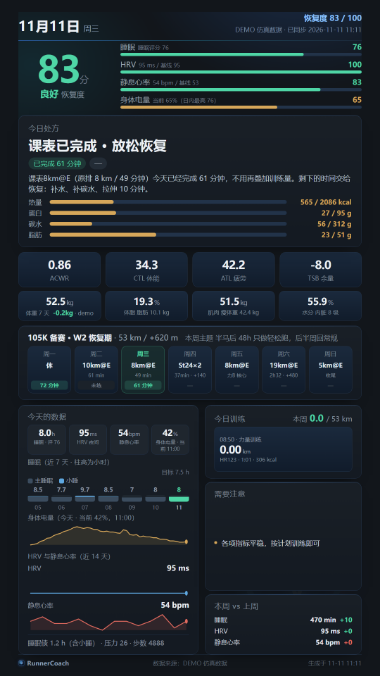
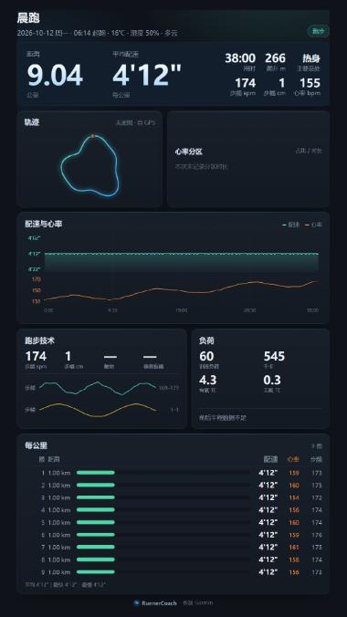
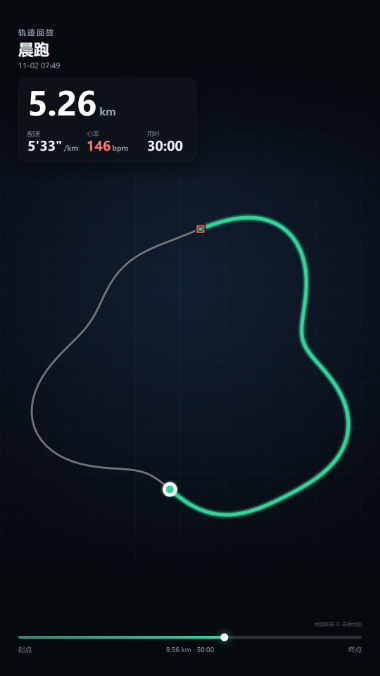
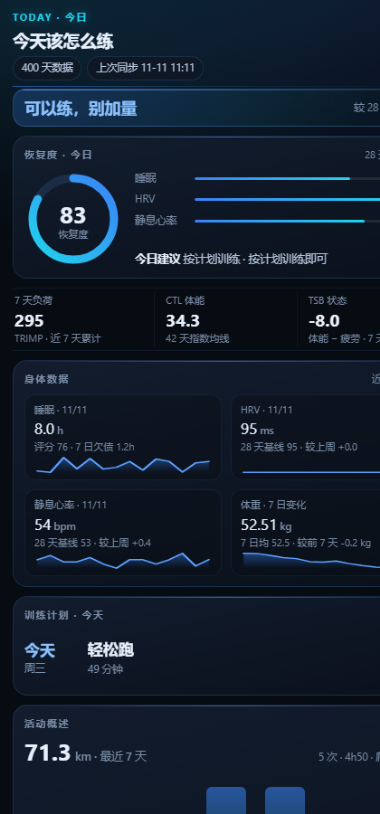
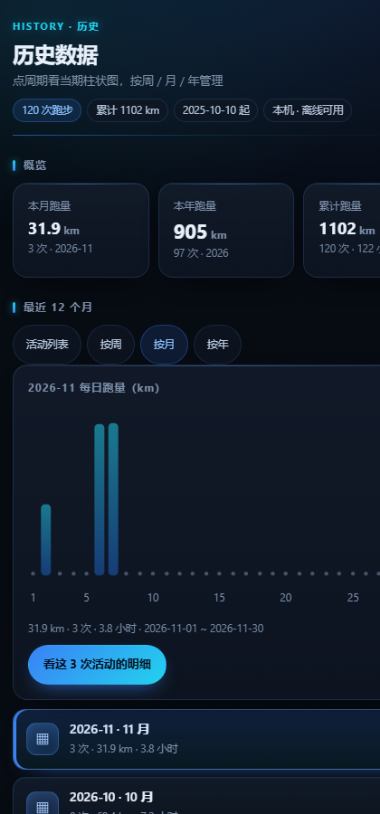
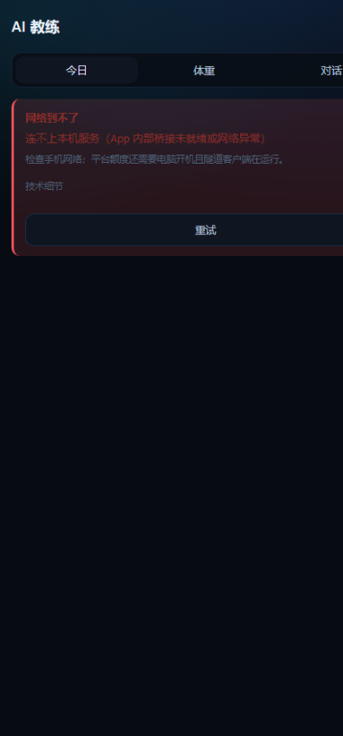
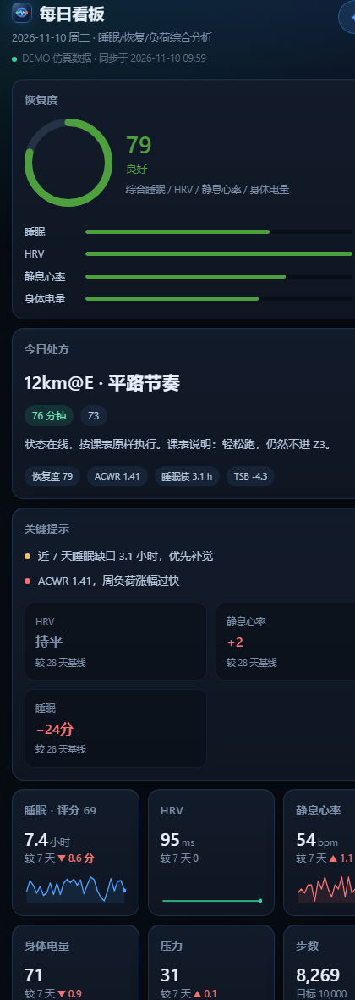

# RunnerCoach

**把跑表里的数据，变成「今天该怎么练」和一张能直接发出去的成绩单。**

本地优先 · 佳明国区 + 高驰双数据源 · 零第三方依赖 · 断网可用

> 下面所有截图都来自 `demo` 仿真数据（[`tools/readme_shots.py`](tools/readme_shots.py) 可一键重现），
> 不含任何真实账号、GPS 轨迹或健康数值。

| 一图流 · 1080×1920 | 单次活动图 | 轨迹回放成片 |
|:--:|:--:|:--:|
|  |  |  |
| 睡眠 / 恢复 / 负荷 / 今日课表，一屏说完 | 分圈、配速曲线、心率区间、轨迹与天气 | 轨迹逐米回放，可插入自己拍的视频与照片 |

---

## 手机端

不给命令行的场合，有一个同内核的安卓 App（`android/`）。它不重画界面，直接渲染同一套 HTML，
所以**看板、出图、历史、教练**在电脑和手机上长得一模一样。

| 今日 | 历史 | AI 教练 |
|:--:|:--:|:--:|
|  |  |  |
| 恢复度、负荷、今日处方、最近活动 | 月跑量柱状图 + 周/月/年管理，可一键补全历史 | 用本地算好的数据回答「今天为什么这么练」 |

再往下是完整的每日看板（点「完整看板」进入，和桌面版同一个页面）：

<p></p>

**App 里还有**：下拉同步、历史在后台由近到远自动补齐（每次刷新推一段，最多回溯 8 年）、
素材批量添加（图片/视频多选）、素材多选删除、再次剪辑、旋转、竖屏素材按真实比例展示、
一键导出 / 导入数据包（换手机不丢历史）、诊断日志、深空科技风主题。

---

## 支持的数据源

| 数据源 | 怎么接 | 能拿到什么 |
|---|---|---|
| **佳明国区**（connect.garmin.cn） | 账号密码登录 / 导入 Cookie / 会话自动续期 | 最全：日汇总、睡眠分期、HRV、压力、血氧、呼吸、身体电量、活动列表 + 1Hz 明细、训练计划、课表推送 |
| **高驰 COROS**（Training Hub） | 账号密码登录，token 存本机 | 活动（轨迹、分圈、心率、功率、爬升）+ 每日静息心率 / HRV / 训练负荷 / VO2max / 步数卡路里 |
| **小米健康云**（可选） | 账号登录，AES 私有协议 | 体重、体脂、肌肉量、水分等体成分 |
| **华为运动健康**（可选） | 导入会话或 HAR 抓包登录，token 自动续期 | 体重、体脂、肌肉量、水分等体成分（云端读，不依赖手机） |
| **体成分 CSV** | 直接导入体脂秤导出文件 | 同上，不依赖任何云 |
| **照片 / 视频** | 相册多选 | 按拍摄时间插进轨迹回放，可裁剪、旋转 |

两套表数据可以**同时接**：活动按来源分别入库，同一天两边都有的字段按非空合并，
活动图上会标 `COROS 高驰` 或 `Garmin`。

已知边界（不粉饰）：

- 佳明只支持**国区**，国际区接口不同，未适配。
- 高驰拿不到**睡眠分期**：那套数据只在移动端私有协议里，登录一次会把手机上的高驰 App 挤下线，代价太大。
- 高驰没有训练计划接口，这类功能自动回落到佳明或本地课表。

---

## 它到底算什么

不是又一个「步数统计」。三件事：

**1. 把散落的指标变成一句结论。**
恢复度 0–100（睡眠 35% / HRV 30% / 静息心率 20% / 身体电量 15%）、
训练负荷 CTL / ATL / TSB / ACWR、睡眠债、周环比、体重与体成分趋势 —— 全部本地规则计算，
不依赖任何大模型，口径固定在 `metrics.py` / `coach.py` 里。

**2. 给出今天该干什么。**
规则引擎按恢复度、负荷和课表排今天的处方：练什么、练多久、什么强度、为什么。
备赛期可以挂 105K / 全马计划，自动算出本周里程、爬升与主题。

**3. 产出能直接发出去的东西。**
一图流、活动图、回放视频、每日看板、微信简报——全是自包含文件，无外链、无 CDN，
`file://` 双击就能开。

---

## 能力清单

| 分类 | 能力 |
|---|---|
| 分析 | 恢复度与成因拆解、睡眠债、CTL / ATL / TSB / ACWR、步频步幅重算、心率漂移、配速分段 |
| 分析 | 营养目标（蛋白 / 碳水 / 脂肪）与饮食记录、体重体成分趋势、RED-S 风险联合判断 |
| 训练 | 今日处方、周课表、备赛计划、训练计划读取、间歇自动识别（快组 / 慢组双栏） |
| 训练 | 课表推送成佳明训练课程（**仅桌面端** `run.bat push`） |
| 产出 | 每日看板 HTML、一图流 1080×1920、单次活动图、轨迹回放 MP4、纯文本简报、教练上下文 Markdown |
| 历史 | 周 / 月 / 年三种视角、月跑量与当期每日柱状图、按周期看明细、刷新时后台自动补齐 |
| 迁移 | 一键导出数据包（zip）、导入覆盖（先自动备份旧库）、诊断日志一键复制 |
| 素材 | 轨迹回放里插图片/视频、批量添加、多选删除、再次剪辑、旋转、竖屏适配 |
| 展示 | 深空蓝暗色主题、手机 / 平板 / 桌面自适应、下拉刷新 |
| 可选 | AI 教练对话（自配 OpenAI 兼容 API）、高德静态底图（自备 Key）、MCP 工具、局域网只读浏览 |

**没有高德 Key 也能用**：轨迹回落成矢量折线，回放底板是冷色网格——不是白屏也不是报错。

---

## 三种用法

| 形态 | 适合谁 | 出图 | 门槛 |
|---|---|:--:|---|
| **安卓 App** | 只用手机、不碰命令行 | ✅ | 装 APK，下拉同步 |
| **桌面 CLI + 本地网页** | 有电脑、想改代码或批量出图 | ✅ | Python 3.11+ |
| **Termux / 局域网只读** | 想在手机上看结果 | HTML | `setup-termux.sh` 或 `serve --lan` |

---

## 快速开始

### 先看效果（不需要账号、不联网）

```bash
git clone https://gitee.com/liyufei-lyle/RunnerCoach.git
cd RunnerCoach
```

```bat
run.bat demo --open          :: Windows
```

```bash
./run.sh demo                # Linux / macOS / Termux
```

会生成 60 天仿真数据并打开看板：`output/demo.html`。`run.bat doctor` 是环境自检，
`run.bat selftest` 是完全离线的回归测试。

> 出 PNG 用本机 Chrome / Edge；导出 MP4 还需要 `ffmpeg`。都没有也不影响使用——
> 会自动退化成 HTML，手机打开就是整张图。

### 接上自己的账号

```bat
run.bat login                    :: 佳明国区登录（可能要邮箱验证码）
run.bat sync --days 30           :: 同步最近 30 天
run.bat report --open            :: 出看板
run.bat card                     :: 出一图流
run.bat act --id <活动ID> --card  :: 出单次活动图
run.bat motion --id <活动ID>      :: 出轨迹回放
```

高驰用户：

```bat
run.bat coros login
run.bat coros sync --days 30
```

两边都接了就照常 `report` / `card`，图上会标数据来源。

### 换电脑 / 换手机

数据都在本机，搬家靠一个 zip：

```bat
run.bat export                  :: 生成 output/exports/RunnerCoach-data-*.zip
run.bat import <那个 zip>        :: 覆盖当前数据（先自动备份旧库）
```

App 里是「我的 → 导出数据 / 导入数据」，导出会同时存进「下载/RunnerCoach」并可直接分享。
包里只含训练与健康数据，**不含账号密码、会话和照片原文件**。

完整命令见 [`docs/使用手册.md`](docs/使用手册.md)。

---

## 隐私与安全

这一层的取舍决定了这个项目长什么样。

1. **数据不出本机。** 没有服务端、没有账号体系、没有遥测。同步是「本机直接连官方接口」，
   不存在中间人。
2. **不做代登录服务。** 佳明条款不允许向第三方共享凭据，所以这个项目**永远**不会变成
   「你填账号、我帮你拉」的网站或小程序。
3. **凭据等同密码。** `config.json`、`data/session.json`、`data/coros_auth.json` 都在
   `.gitignore` 里；安卓版密码存 Keystore。不要把整个项目目录打包发人。
4. **轨迹 = 精确行踪。** 分享前可用脱敏档位：`trim` 裁掉首尾各 200 m（默认）、
   `hide` 完全隐藏轨迹；脱敏在生成 HTML 之前完成，产物里不留原始折线。
5. **截图只用仿真数据。** README 里这些图都由 `demo` 生成，脚本在
   [`tools/readme_shots.py`](tools/readme_shots.py)，你可以自己跑一遍复现。

完整口径见 [`docs/隐私说明.md`](docs/隐私说明.md)（App 内「我的 → 关于」也能直接打开）。

---

## 常见问题

**需要科学上网吗？**
不需要，走 `connect.garmin.cn`。

**支持佳明国际区 / 其他品牌吗？**
国际区不支持（接口不同）。高驰、华为运动健康（体成分）已接入；其他品牌暂无计划。

**数据会不会被上传到某个服务器？**
不会。除了你主动调用的官方接口和可选的 AI 接口，没有任何出网请求。

**为什么非要装在本地？**
一是合规（不能代他人登录），二是隐私（轨迹和健康数据太敏感），三是离线可用——
出图、看板、历史全都不需要网络。

**AI 是必需的吗？**
不是。所有判断都由规则引擎给出；AI 只负责把算好的结论讲成人话，删掉不影响任何功能。

**手机上要重新登录吗？**
会话会自动续期并落盘；只有服务端彻底作废票据时才需要重新登录。

**一图流里的某些数字是「—」？**
说明这一项还没同步到（比如今天还没同步、或设备没测）。先下拉同步一次再看。

---

## 技术实现

- **零第三方依赖**：全部 Python 标准库（`sqlite3` / `http.client` / `http.server` / `ssl`），
  没有 `pip install` 这一步。
- **本地 SQLite** 存日汇总、活动、明细、体成分、计划；同步是增量的，已覆盖的日子会跳过。
- **产物自包含**：看板/图片不引用任何外部资源，可直接转发。
- **手机端**用 [Chaquopy](https://chaquo.com/chaquopy/) 内嵌 CPython + WebView，
  出图不走无头浏览器而是离屏 WebView；[`garmin_cn/exportspec.py`](garmin_cn/exportspec.py)
  统一了桌面与手机 1080×1920 的画幅。
- **可回归**：`selftest` 覆盖解析、指标、渲染、UI 结构，改完先跑它；
  断言在 `garmin_cn/selftest.py`，入口只留薄包装（不进 APK）。

目录结构（只列主干）：

```
RunnerCoach/
├─ cli.py                命令行入口（命令实现，逻辑都在 garmin_cn/）
├─ garmin_cn/            接入 / 计算 / 产出 / 集成
│   ├─ selftest.py       离线自检（桌面端）
│   ├─ housekeeping.py   缓存上限与磁盘清理
│   └─ tls.py            共享 SSL context
├─ android/              安卓 App（Kotlin + WebView，release 走 R8）
├─ tools/                开发期工具（发版、截图、校验）
├─ docs/                 手册、字段清单、方案与截图
├─ data/ output/         本机数据与产物（不提交）
```

改动约定、接口分层见 [`docs/协作流程.md`](docs/协作流程.md) 与 [`docs/APP方案.md`](docs/APP方案.md)。

---

## 文档

| 文档 | 内容 |
|---|---|
| [`docs/使用手册.md`](docs/使用手册.md) | 全部命令、登录排错、指标口径、底图、回放与素材流程 |
| [`docs/交付形态调研.md`](docs/交付形态调研.md) | 为什么选本地形态、隐私检查项 |
| [`docs/APP方案.md`](docs/APP方案.md) | 安卓端路线取舍与踩坑记录 |
| [`docs/高驰接入评估.md`](docs/高驰接入评估.md) | 高驰三条取数通路的对比与结论 |
| [`docs/华为体重自动同步调研.md`](docs/华为体重自动同步调研.md) | 华为健康云已验证协议：三家主机分工、token + x-huid 认证、游标翻页、续期 |
| [`docs/activity-data-inventory.md`](docs/activity-data-inventory.md) | 国区接口分层与字段清单 |
| [`docs/发布流程.md`](docs/发布流程.md) | 版本规范、正式签名、打包校验、APK 分发与回滚 |
| [`docs/隐私说明.md`](docs/隐私说明.md) | 收集什么、存在哪、什么时候出网、怎么删 |
| [`docs/0.6.0-checklist.md`](docs/0.6.0-checklist.md) | 1.0 发布清单与验收标准 |

---

## 协作与许可

欢迎提 Issue / PR。三条硬约定：**不引入第三方依赖**、**产物不产生外部请求**、
**不提交任何真实数据**（`demo` 仿真数据除外）。

许可见 [LICENSE](LICENSE)。

- 本项目与 Garmin、佳明、COROS、高驰、小米、高德均无关联，属个人自用工具，使用官方接口的风险由使用者自行承担。
- 接口可能随服务端调整而失效，欢迎一起维护。
- 请勿用于代他人登录、收集他人健康数据或任何商业托管服务。
