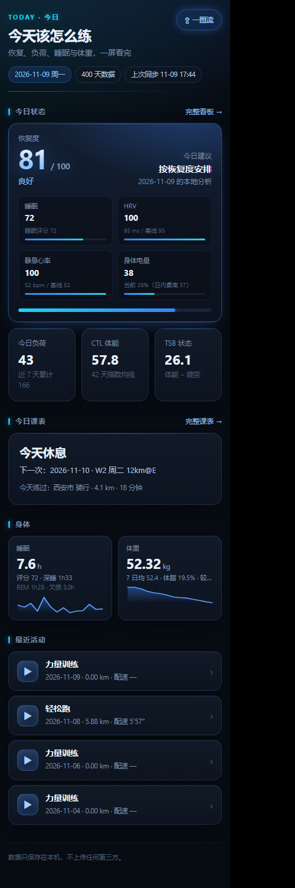
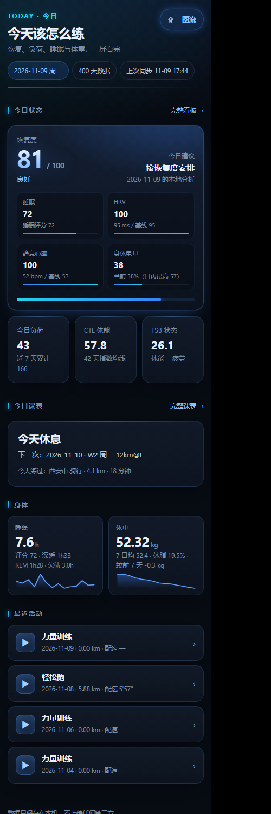

# RunnerCoach 体验与性能评估（v0.6.2）

> 评估时间：2026-11-09　评估对象：`E:\Run\garmin-coach`（内核 `0.6.2`，APK `versionCode 68`）
> 数据来源：`demo` 400 天仿真库（不含任何真实账号、GPS 或健康数值）
> 方法：源码审读 + 本地渲染 + 无头浏览器实测（视口 360 / 390 / 430、布局溢出、字号、触控目标）+ WCAG 对比度计算
> 局限：**没有在真机上跑**（无 ADB），所以「滚动手感、冷启动、耗电」只给测量方法，不下结论；下文标注「实测」的都有具体数字，「推断」的会单独写明。

---

## 一、总体结论

产品逻辑是完整的：同步 → 计算 → 处方 → 出图 → 分享 → 历史，闭环没有断点，页面生成也很快（实测首页 8 ms）。真正拖体验的不是功能，而是**最后一公里的可读性与一致性**：

- 手机上 36 处文字小于 12 px（最小 10 px），最弱的辅助色对比度只有 **2.65:1**（WCAG AA 要求 4.5:1）；
- 5 类可点元素的高度在 19–38 px，低于 40 dp 的舒适区；
- 六个模块各自维护一套色板（22–57 个 hex/模块），同一语义在不同页面是三种绿、四种灰；
- 统计卡在 390 px 下会换行，体重趋势的最后一句被省略号吞掉；
- 计划页每一行都写「未标注强度」，而标题里明明有 `12km@E`。

### 评分（10 分制）

| 维度 | 分数 | 依据 |
|---|---:|---|
| 信息架构 | **8.5** | 4 个 tab + 唯一入口表，二级页归属清晰；`docs/交互树.md` 与实际代码基本对得上 |
| 视觉一致性 | **5.0** | 6 套色板并存，看板用绿、App 用蓝，分享图又是第三种灰 |
| 文字可读性 | **4.0** | 10–11.5 px 大量存在；`--faint` 对比度 2.65–2.81 |
| 交互反馈 | **7.0** | 下拉同步、进度线、返回链都对；但出图/同步仍靠 Toast，且 Toast 里混着开发信息 |
| 无障碍 | **3.0** | 0 处 `aria-*`/`alt`/`role`；可点元素是 `div`；图标用「⇪ ◫ ✂」字符；字号全写死 px |
| 性能 | **7.5** | 页面 6–8 ms、看板 82 ms；固定背景与逐 tab 重载是主要隐患（需真机确认） |
| 数据可视化 | **6.0** | 结构对，但零值柱、缺轴、密集模式无标签；活动图有空白区块 |
| 分享产物 | **6.5** | 一图流信息过载、活动图留白失衡、回放视频字太小 |
| **综合** | **6.2** | 功能完成度 9，体验完成度 6；不需要重构，需要一次「收口」 |

一句话：**把设计 token 收成一套、把 10 px 抬到 11–12 px、把可点区域抬到 40 dp、把该换行的换行**，这套界面就能从「看着挺酷但费眼」变成「每天愿意打开」。

---

## 二、已经成立、不要动的地方

1. **导航与返回链**。一级只留 4 个 tab，`goTab`/`nativeBack` 与 `docs/交互树.md` 第三节完全对应，没有「返回在 tab 间循环」的老问题。
2. **兜底文案**。无数据、无高德 Key、无佳明会话都有明确说法（矢量轨迹 / 本地推算 / 重新读取），而不是空白或报错。
3. **出图链路**。`renderToPng` 的三段自校正（初始缩放 → `visualViewport` 探针 → `contain` 归一到 9:16）是真机踩过坑之后写出来的，比大多数同类实现稳。
4. **本地优先**。页面不引 CDN/字体/统计，`no-store` 只影响本地 15 KB，不影响合规。
5. **生成性能**（实测，桌面 400 天库）：

| 调用 | 耗时 |
|---|---:|
| `ui.home_page()` | 8.0 ms |
| `history.history_page()`（按月） | 5.6 ms |
| `history.history_page()`（按年） | 6.9 ms |
| `ui.me_page()` | 7.5 ms |
| `appapi.dashboard()`（含建 HTML） | 82 ms |
| `appapi.card_html()` | 13 ms |
| `appapi.status()` | 4.2 ms |

也就是说：**Python 侧不是瓶颈**，瓶颈在 WebView 的绘制、网络同步和出图。

---

## 三、P0：影响「能不能舒服地用」，建议下个版本一次清完

| # | 问题 | 证据（文件:行） | 用户感受 | 改法 | 验收 |
|---|---|---|---|---|---|
| P0-1 | 文字过小、辅助色过淡 | `ui.py:31` `--faint:#4E6076`；`ui.py:99` 分项说明 10 px；首页 36 处 <12 px、历史页 39 处 | 「数字看得见，解释看不清」 | 最小字号 11 px，说明文字 12 px；`--faint` 改 `#7689A2` | 页内 <11 px 文本为 0；`--faint` 对比度 ≥4.5 |
| P0-2 | 可点区域偏小 | `ui.py:63` 出图按钮 77×35；`ui.py:87` 「完整看板」62×19；`ui.py:75` 筛选 chip 45×28；`ui.py:197` 主按钮 144×38 | 单手拇指容易点空 | 胶囊按钮 `min-height:32`；链接 `padding:8px 0`；主按钮 `min-height:44` | 所有可点元素 ≥40×40 |
| P0-3 | 三列统计卡换行、体重趋势被截断 | `ui.py:88` 三列；`ui.py:151` `.val` 23 px；`ui.py:116` `.vital .sub` `nowrap+ellipsis` | 「13.5 / km」断行；「较前 7 天 -0.3 kg」直接消失 | 数值与单位分离（单位进标签）；`.sub` 允许两行 | 390 px 下三张卡单行；体重三项信息完整 |
| P0-4 | 计划页「未标注强度」与标题矛盾 | `ui.py:720-733` `_plan_meta`；`plan-390.png` 每行都有 | 觉得数据没解析出来 | 无元信息时不渲染副标题；`W2 周二` 从标题里去掉 | 7 行里 0 处「未标注强度」 |
| P0-5 | 力量训练也显示 `0.00 km / 配速 —` | `ui.py:672-680` 首页活动行只拼距离+配速 | 一条力量课看起来像「跑了 0 公里」 | 按 `type` 分支：跑步给距离/配速，其它给时长/负荷 | 力量训练行不再出现 0.00 km |
| P0-6 | 给用户看开发信息 | `MainActivity.kt:2864-2869` Toast「v0.6.2 出图缩放 ×1.00」；AI 页露出 `TypeError: Failed to fetch`；「我的」显示完整邮箱地址 | 不信任感 + 隐私暴露 | 版本/缩放只在调试包显示；异常统一成「网络没连上，重试」；邮箱掩码 | 正式包里无版本号、无异常类名、无完整邮箱 |
| P0-7 | 无障碍基本为零 | 全模块 0 处 `aria-*`/`role`/`alt`；`ui.py:458`、`ui.py:466` 用 `div[data-act]`；图标是字符 | TalkBack 读不出、也点不到 | 可点容器补 `role="button" tabindex="0" aria-label`；图标字符改 `aria-hidden` | 开 TalkBack 能逐项读出并激活 |

### P0-1 具体口径

| 令牌 | 现值 | 卡片底上的对比度 | 建议值 | 新对比度 |
|---|---|---:|---|---:|
| `--faint` | `#4E6076` | **2.65–2.81** | `#7689A2` | **5.07 / 4.78** |
| `--muted` | `#7C8FA8` | 5.48 | 保留 | 5.48 |
| `--ink` | `#E8F0FB` | 15.79 | 保留 | 15.79 |

`--faint` 目前承载 `.note`、`.mm .d`、`.vital .sub2`、`.foot` 和 `.row .go`——全是「读得懂才有用」的信息，不是装饰。这是单项收益最大的改动：**改一行变量，全站生效**。

### P0-3 的截图证据

同一份 HTML、同一视口（390 px），只改 CSS：

| 改前 | 改后（只加了一段 CSS 覆盖） |
|---|---|
|  |  |

改后：胶囊从 28 px 高变成 32 px，说明文字从 10–11.5 px 抬到 11–12 px；**体重卡第二行「较前 7 天 -0.3 kg」从小屏上消失变成完整显示**。这就是 `.sub` 的 `white-space:nowrap + ellipsis` 造成的真实信息丢失。

### P0-6 补充

- `MainActivity.kt:2864` 的 `toast("$ver 出图缩放 ×…")` 是调试用；正式包应只在调试构建里显示（用 `ApplicationInfo.FLAG_DEBUGGABLE` 判断即可，工程目前没引用 `BuildConfig`）。
- AI 页把 `TypeError: Failed to fetch` 原样渲染在红色卡片里（`docs/img/app-ai.png`）。用户只需要一句「连不上模型服务，检查网络后重试」，异常原文进「诊断日志」。
- 「我的 → 数据源」直接显示完整登录邮箱（`ui.py:964-965`）。这与项目自己的隐私立场不一致，也与 `appapi.py:330 _mask_uid` 的做法不一致。建议统一掩码成 `a***@qq.com`。

---

## 四、P1：视觉系统与信息层级（「美化」的主体）

### 4.1 色板已经漂成六套

| 模块 | 独立 hex 数 | 同一语义的不同值 |
|---|---:|---|
| `ui.py`（App 外壳） | 22 | 绿：无；琥珀 `#F5A524`；蓝 `#5EA0FF` |
| `report.py`（看板） | 27 | 绿 `#34D399` / `#4ADE80`；琥珀 `#F5C26B`；蓝 `#4DA3FF` |
| `card.py`（一图流） | 31 | 灰 `#7F8A97` / `#8C97A4` / `#6C7683`；绿 `#2FBF8F` |
| `actcard.py`（活动图） | 57 | 灰 `#7C8A99` / `#7E8C9B`；绿 `#2FBF8F` / `#39A98A` |
| `aiui.py`（教练页） | 23 | 变量名 `--ink-2`（别的模块是 `--ink2`） |
| `motion.py`（回放） | 25 | 绿 `#34D399` / `#2FBF8F` |

结果：**同一张「今天」页是科技蓝，点进「完整看板」变成绿色为主，导出的一图流变成灰蓝。** 三张截图放在一起像三个产品。

建议（不动配色风格，只做收口）：

1. 新建 `garmin_cn/tokens.py`，一组语义变量：`bg / surface / surface2 / line / ink / ink2 / muted / faint / brand / brandInk / cyan / ok / warn / bad / radius / shadow`。
2. `ui.py`、`report.py`、`card.py`、`actcard.py`、`aiui.py` 的 `:root` 与 `MainActivity` 的 ARGB 常量都从这里**生成**（`str.format` 注入），不再手写十六进制。
3. 状态色只保留三档：`ok=#34D399`、`warn=#F5A524`、`bad=#F2555A`。看板和 App 统一用这一套；`#2FBF8F` 这类近义绿全部删掉。
4. `docs/交互树.md:112` 写的「涨/达成用红，跌/不足用绿（A 股习惯）」与代码（绿=良好）相反，是旧文案残留，建议改成「达成/良好=绿，异常=红，注意=琥珀」。

### 4.2 字号阶梯（现在只有「大/中/小/更小」四档，且都偏小）

| 角色 | 现在 | 建议 | 用在哪 |
|---|---:|---:|---|
| 页标题 | 24 | 26 | `page-head h1` |
| 区块标题 | 20 | 20 | `plan-hero .t` |
| 主数值 | 23–46 | 24 / 46 | `stat .val` / 恢复度 `.big` |
| 正文 | 13–14 | 14 | `lede`、`.plan-hero .d` |
| 卡片副文 | 11.5 | 12.5 | `.note`、`.vital .sub` |
| 标签/单位 | 10.5–11.5 | **11**（下限） | `.k`、`.lab`、`.chip`、`.d` |
| 页脚/脚注 | 11 | 12 | `.foot` |

并在 `:root` 里定 `--fs-label / --fs-body / --fs-cap`，以后不再散写。当前 `ui.py` 里有 **37 处** `10–12px` 声明，只能靠阶梯才能管住。

### 4.3 卡片密度：每块都是卡，等于没有重点

现在的规律是「分区标题 + 一张卡」，首页一屏 6 个区块、7 张卡、3 层背景（body 渐变 → card 渐变 → 卡内 `.mm .i` 又一层）。视觉噪音来自三处：

- **全局重复**：恢复度卡里 4 个分项各有一条 3 px 进度条，卡片底部又有一条总进度条（`ui.py:630`），同一件事画两遍。
- **双强调**：`card.brand` 用辉光 + 内层 4 个子卡 + 大数字渐变文字，一张卡里 3 种强调手法。
- **图标底**：`.row .ic` 的渐变底 + 内发光在 4 个 tab 里重复出现上百次（`ui.py:167-171`）。

建议的层级规则（按优先级只允许一种强调）：

| 层级 | 表现 | 用在哪 |
|---|---|---|
| L1 结论 | 大数字/大字标题 + 品牌色 | 恢复度分数、今日处方标题 |
| L2 关键值 | 20–24 px 白字 | CTL / TSB / 睡眠时长 |
| L3 解释 | 12 px `muted` | 「42 天指数均线」 |
| L4 元信息 | 11 px `faint`（改后可读） | 时间、来源、计数 |

具体三步：
1. 删掉恢复度卡底部那条总进度条（分数已经有 46 px 大字 + 4 个分项）。
2. `.card` 的 `::after` 顶部高光只保留给 `card.brand`，普通卡改纯描边——一屏就少 6 条发光细线。
3. `.row .ic` 改为「单色描边 + 同色 12% 底」，去掉 `inset box-shadow`；图标语义靠字形区分即可。

### 4.4 首页信息顺序

现在：状态卡（恢复度 + 3 数）→ 今日课表 → 身体（睡眠/体重）→ 最近活动。
问题：**「今天该怎么练」这个标题承诺的答案，藏在第 2 屏**，而「今日建议」被挤在恢复度卡右侧的小字（`ui.py:627`），还和左边的「恢复度 81」语义重叠。

建议顺序（高度不变，内容换位）：

```
① 一句话结论（24px）        今天：休息 + 补恢复
② 恢复度环 + 3 个关键数     81 / 负荷 43 / TSB 26.1
③ 今日课表（合并"下一次"） 今天休息 · 明天 12km@E
④ 身体（睡眠 / 体重）
⑤ 最近活动
```

「一句话结论」不用新逻辑：`ui.py:710` 的 `_session(res)` 已经在算「按恢复度安排」这类结论，把它从卡片右侧的小字提到页顶即可。

#### 顺手的文案替换（不用改逻辑，只改字符串）

| 现在 | 建议 | 原因 |
|---|---|---|
| `下一次：2026-11-10 · W2 周二 12km@E` | `明天 · 12 km 轻松跑（E 区）` | `W2 周二` 与左侧「周二」重复，`@E` 是训练圈黑话 |
| `近 7 天累计 166` | `7 天累计 166` | 三列卡里会折成两行 |
| `52 bpm / 基线 52` | `52 bpm（基线 52）` | 斜杠在中文语境里像「或」 |
| `2026-11-09 的本地分析` | `按本机数据推算` | 「本地分析」是开发口径，不是用户语言 |
| `出图缩放 ×1.00` | `已生成图片` / `正在生成…` | 调试信息，见 P0-6 |

### 4.5 图表（`history.py:134 _month_bars`）

现在的问题与改法：

| 问题 | 现在的实现 | 改法 |
|---|---|---|
| 没跑的日子也有一根 6 px 柱 | `history.py:157` `h = 6 + …`，`km=0` 也画 | `km<=0` 不画柱，改画 1.5 px 基线点（同色 35% 不透明） |
| 密集模式完全没有数值 | `dense = n > 14` 时 `show_lab` 全关 | 至少给最大值那根画数值 + 一条平均值虚线 |
| 没有 Y 轴 | 只有 X 轴标签 | 右侧标 `max` 与 `avg` 两个刻度，柱状图归一化到固定上限（如 4 周均值的 1.5 倍） |
| 柱子是装饰而非读数 | 渐变 + 0.52 透明 | 达标日实色、未达标日同色 50%，当前周/月保留高亮 |

改后效果（示意）：一个月 30 根柱子里只有 8 天有数据，现在是「一条毛毛虫」，改后是「8 根柱 + 22 个点」，扫一眼就知道哪天没跑。

### 4.6 三份分享产物

**一图流（`card.py`，1080×1920）**

- 现在 9 个区块（恢复/处方/营养/负荷/备赛/今日数据/今日训练/注意/周对比），信息密度按「自己看」设计的，不适合发朋友圈。
- 建议出两档：`card --mode summary`（结论 + 3 数 + 1 张负荷曲线 + 来源，占 60% 画幅）与现在的 `full`。分享场景 90% 用 summary。
- 字体：`card.py` 里 16–21 px 的「1080 画幅字号」实际只相当于手机 5–7 pt，正文（`.why` 21 px）在缩略图里几乎不可读；建议正文 24–26 px。

**活动图（`actcard.py`）**

- 「心率分区」区块在没记录时仍是半张卡的空文案（`docs/img/activity.png` 右侧），应折叠成一行「本次未记录心率区间」。
- 「每公里」里 9 行 `1.00 km` 的柱子完全等长，柱子不承载信息；改成「相对平均配速的偏差条」（快=蓝，慢=琥珀）。
- 「垂直步幅」三张小折线没有单位/刻度，属于装饰；要么合并成一行「步频 174 · 步幅 1.21 m · 触地 268 ms」，要么给最小/最大标签。
- 配速/心率曲线图区只有约 60 px 高，两条线都压成直线；至少 110 px，并给双轴刻度。

**回放视频（`motion.py`）**

- 5.08 km 的成片里，左上信息块只占画面 1/6，其余是空网格；建议：距离做成 72 px 大字、当前配速做实时气泡、每公里打点、进度条从 2 px 加粗到 6 px。
- 无底图时是冷色网格（这个兜底很好），但可以再叠一层「等距高程带」或经纬网刻度，让空网格看起来是设计而不是没加载。

### 4.7 README 截图右侧被裁（工具问题，不是布局问题）

`docs/img/app-today.png`、`app-history.png`、`dashboard.png` 的右边缘都被切掉了：卡片缺一角、chip 断在「本机 · 离…」。

原因我实测确认了：**Chrome 的最小布局宽度是 500 px**，`tools/readme_shots.py:172` 传 `--window-size=420,900`，浏览器仍按 500 排版，截图只截到左边 420，于是右侧 80 px 丢失。这不是 App 的响应式 bug（我在 360 / 390 / 430 三个宽度实测 `scrollWidth == clientWidth`，**零横向溢出**）。

修法（`shot()` 里加一层视口容器，我在本次评估就是这么截的）：

```python
def shot(html, png, width, height, *, wait=3000, query=""):
    page = html.resolve().as_uri() + (("?" + query) if query else "")
    wrap = html.with_name(html.stem + "-vp.html")
    wrap.write_text(
        "<!doctype html><meta charset='utf-8'><style>html,body{margin:0;background:#070B12}"
        f"iframe{{width:{width}px;height:{height}px;border:0;display:block}}</style>"
        f"<iframe src='{page}'></iframe>", encoding="utf-8")
    subprocess.run([_browser(), "--headless=new", "--disable-gpu", "--hide-scrollbars",
                    "--allow-file-access-from-files",
                    f"--window-size={max(width, 520)},{height}",
                    f"--virtual-time-budget={wait}",
                    f"--screenshot={png.resolve()}", wrap.resolve().as_uri()], ...)
```

---

## 五、P2：性能（实测 + 推断分开）

| 项 | 现状 | 结论 |
|---|---|---|
| 页面生成 | 5.6–8.0 ms（桌面） | 不是瓶颈 |
| 单页体积 | 首页 22.3 KB / 历史 24.8 KB / 教练页 41.1 KB | 本地回环，可接受 |
| CSS 占比 | `ui.CSS` 15.1 KB = 首页 **68%**，每页内联、`no-store` | 每次导航重复传输+解析 |
| 看板重出 | 82 ms + 一次 `bodyBattery` 网络往返（TTL 内跳过） | 同步后无条件触发，可懒生成 |
| 出图位图 | `ARGB_8888` 1080×约 2000 ≈ 8.6 MB，外加软件层 WebView | 低端机上有内存峰值风险（推断） |

### 5.1 固定背景是滚动流畅度的头号嫌疑（推断，需真机确认）

`ui.py:44-48`：

```css
body{background: radial-gradient(...) , radial-gradient(...) , var(--bg);
     background-attachment:fixed}
```

`background-attachment: fixed` 在 Android WebView 上会让整页在每次滚动时重绘背景（而不是缓存成层），叠加两个大半径 `radial-gradient`，中低端机容易出现「滚动掉帧、下拉刷新时闪一下」。改成固定伪元素即可，视觉零变化：

```css
body{background:var(--bg)}
body::before{content:"";position:fixed;inset:0;z-index:-1;pointer-events:none;
  background:
    radial-gradient(900px 520px at 78% -8%, rgba(59,130,246,.17), transparent 62%),
    radial-gradient(680px 420px at 6% 2%, rgba(34,211,238,.10), transparent 60%)}
```

同理，`.big`（`ui.py:137-141`）用 `background-clip:text + drop-shadow` 给小屏 GPU 增加一次离屏合成；只在恢复度这一处用没问题，但**不要扩散到其他数字**。

### 5.2 同步是串行的，两个数据源可以并行

`MainActivity.kt:527-563`：先 `sync`（佳明）再 `coros_sync`，两段网络完全独立。两个账号都配的用户，同步时间≈两者相加。用 2 线程池并发（`http.client` 是 I/O 阻塞，GIL 不挡），**墙钟时间约等于较慢的那个**（经验值省 30–45%，需真机实测）。

### 5.3 每次下拉都触发「补齐历史」一段

`MainActivity.kt:579` 在每次刷新后调 `runBackfill()`，最多循环 12 段、每段一年。用户只是想看今天的数据，却可能在后台连发几十个请求，弱网下会和下次下拉抢带宽。建议：补齐只在「空闲 30 s 后」或「充电/息屏」时跑，并且限速 1 段/次刷新。

### 5.4 切 tab 是整页重载

`goTab` 直接 `web.loadUrl()`（`MainActivity.kt:369`），每次切 tab 都会重新请求 + 重新解析 15 KB CSS，并伴随一次白/黑闪。两条路：
- 保守：保留 4 个 WebView（每个 ~30–50 MB，中端机可接受），切换只 `show/hide`；
- 更省：把 `ui.CSS` 抽成 `/ui.css`（`Cache-Control: max-age=31536000` + 版本号 query），至少去掉 68% 的重复解析。

### 5.5 出图内存

`renderToPng` 里 `Bitmap.createBitmap(1080, ~2000, ARGB_8888)`（`MainActivity.kt:2793`）之后又 `createBitmap` 裁剪、`createScaledBitmap` 缩放，同时存在 2–3 张全尺寸位图。建议裁剪后立刻 `raw.recycle()`，缩放用 `Bitmap.createBitmap` + `Canvas.drawBitmap` 复用同一张目标位图（代码里 `fitToFrame` 已经是这个思路，只需把中间那张回收掉）。

### 5.6 怎么量（不靠感觉）

- 滚动帧率：debug 包开 `chrome://inspect` → Performance 面板录 10 s 滚动，看 `Frame` 是否 >16.7 ms；
- 冷启动：`adb shell am start -W` 看 `TotalTime`（Chaquopy 初始化通常 0.8–2 s，这一段是黑屏，建议加一个静态启动图/标题占位）；
- 同步：`adb logcat` 打点 `sync start/end`，对比并行前后；
- 出图：`adb shell dumpsys meminfo mm.runnercoach.app` 在出图前后各取一次。

---

## 六、可直接落地的补丁

### 补丁 1：`garmin_cn/ui.py` — 可读性与触控（改 10 行，全站生效）

```diff
-  --ink:#E8F0FB; --ink2:#B7C7DD; --muted:#7C8FA8; --faint:#4E6076;
+  --ink:#E8F0FB; --ink2:#B7C7DD; --muted:#7C8FA8; --faint:#7689A2;
+  --fs-label:11px; --fs-cap:12px; --fs-body:14px;
@@ .chip
-  font-size:11.5px;padding:4px 10px;
+  font-size:12px;padding:6px 11px;min-height:32px;line-height:20px;
@@ .head-act
-  font-size:12px;font-weight:600;padding:7px 13px;
+  font-size:12.5px;font-weight:600;padding:0 14px;min-height:40px;
@@ .more
-  font-size:12px;color:var(--brand-ink);
+  font-size:12.5px;color:var(--brand-ink);padding:8px 0;display:inline-flex;
@@ .btn
-  padding:8px 14px;font-size:12.5px;
+  padding:10px 16px;font-size:13px;min-height:44px;
@@ .vital .sub
-  font-size:11px;...white-space:nowrap;overflow:hidden;text-overflow:ellipsis;
+  font-size:12px;line-height:1.45;white-space:normal;display:-webkit-box;
+  -webkit-box-orient:vertical;-webkit-line-clamp:2;
@@ .mm .d
-  font-size:10px;
+  font-size:11px;line-height:1.45;
@@ .val
-  font-size:23px;font-weight:650;
+  font-size:21px;font-weight:650;white-space:nowrap;
```

### 补丁 2：`garmin_cn/history.py` — 零值不再画假柱

```diff
 for i, m in enumerate(months):
     km = float(m.get("km") or 0)
-    h = 6 + (H - pad_b - pad_t) * (km / vapor)
-    x = i * (bw + gap)
-    y = H - pad_b - h
+    x = i * (bw + gap)
+    show_lab = (not dense) or i == 0 or (i + 1) % 5 == 0 or i == n - 1
+    lab = (f'<text x="{x + bw / 2:.0f}" y="{H - 12}" text-anchor="middle" '
+           f'font-size="11" fill="#B7C7DD">{_esc(m.get("label") or "")}</text>'
+           if show_lab else "")
+    if km <= 0:                       # 没跑的日子画基线点，不画 6px 假柱
+        bars.append(f'<circle cx="{x + bw / 2:.0f}" cy="{H - pad_b - 1:.0f}" '
+                    f'r="1.5" fill="#7689A2"/>' + lab)
+        continue
+    h = 6 + (H - pad_b - pad_t) * (km / vapor)
+    y = H - pad_b - h
```

> 原来的顺序是「先算柱高、再拼标签」，改成「先定 x 与标签、再决定画柱还是画点」；`show_lab` / `dense` 的逻辑沿用原值，不会改变刻度密度。

### 补丁 3：`garmin_cn/ui.py` — 去掉「未标注强度」与重复的星期

```diff
 def _plan_meta(item: dict) -> str:
     bits = []
     ...
-    return " · ".join(bits) or "未标注强度"
+    return " · ".join(bits)
@@ plan_page 的周列表
-    wb = (f'<span class="wb">{esc(first.get("name") or "训练")}'
-          f'<em>{esc(_plan_meta(first))}</em></span>')
+    name = re.sub(r"^W\d+\s*周[一二三四五六日]\s*", "", first.get("name") or "训练")
+    meta = _plan_meta(first)
+    wb = (f'<span class="wb">{esc(name)}'
+          + (f'<em>{esc(meta)}</em>' if meta else "") + '</span>')
```

### 补丁 4：`garmin_cn/ui.py` — 数值与单位分离（解决三列换行）

```diff
- ui.stat("本月跑量", f"{float(cur_m.get('km') or 0):.1f} km",
-         f"{cur_m.get('count') or 0} 次 · {cur_m.get('key') or ''}") +
- ui.stat("本年跑量", f"{float(cur_y.get('km') or 0):.0f} km",
-         f"{cur_y.get('count') or 0} 次 · {cur_y.get('key') or ''}") +
- ui.stat("累计跑量", f"{float(total.get('km') or 0):.0f} km",
+ ui.stat("本月跑量", f"{float(cur_m.get('km') or 0):.1f}",
+         f"{cur_m.get('count') or 0} 次 · {cur_m.get('key') or ''}", unit="km") +
+ ui.stat("本年跑量", f"{float(cur_y.get('km') or 0):.0f}",
+         f"{cur_y.get('count') or 0} 次 · {cur_y.get('key') or ''}", unit="km") +
+ ui.stat("累计跑量", f"{float(total.get('km') or 0):.0f}",
          f"{total.get('count') or 0} 次 · {float(total.get('dur_h') or 0):.0f} 小时") +
```

> `history.py:291-296` 是这段的原文。`stat()` 已经支持 `unit` 参数（`ui.py:432`），只是历史页一直把单位拼进值里。`13.5 km` 在 23 px 下需要 82 px，而卡片内容宽只有 82 px——**必然换行**；拆开后可降到 55 px。配合补丁 1 里把 `.val` 降到 21 px 并加 `white-space:nowrap`，三列就回到单行。

### 补丁 5：`MainActivity.kt` — 开发信息不出正式包

```diff
-            val ver = try { packageManager.getPackageInfo(packageName, 0).versionName ?: "?" } catch ...
-            toast("$ver 出图缩放 ×" + String.format(Locale.US, "%.2f", f))
+            // 项目没有开 buildConfig 特性，用 debuggable 标记判断即可
+            val debuggable = (applicationInfo.flags and ApplicationInfo.FLAG_DEBUGGABLE) != 0
+            if (debuggable) {
+                val ver = packageManager.getPackageInfo(packageName, 0).versionName ?: "?"
+                toast("$ver 出图缩放 ×" + String.format(Locale.US, "%.2f", f))
+            }
```

> 注：工程里目前没有引用 `BuildConfig`（AGP 8 默认不生成），所以上面用 `ApplicationInfo.FLAG_DEBUGGABLE` 判断，不需要改 Gradle。

---

## 七、实施路线

| 批次 | 内容 | 估时 | 验收指标 | 怎么验 |
|---|---|---|---|---|
| **第 1 批（体验止血）** | 补丁 1–5 + 计划页/活动行文案 | 0.5–1 天 | <11 px 文本 0 处；可点元素 ≥40 dp；三列卡不换行；体重三项完整；无「未标注强度」；正式包无版本号/异常类名/完整邮箱 | 本次用过的 390 px 量测脚本（可落成 `tools/audit_ui.py`） |
| **第 2 批（视觉收口）** | `tokens.py` + 五处 `:root` 生成 + 去重辉光/总进度条 | 1–2 天 | 六模块同一语义同色值；首页强调层级 ≤2 种 | 截图对比；`grep` 扫描裸 hex |
| **第 3 批（图表与产物）** | 零值点、Y 轴/平均线；活动图三处；一图流 summary 档 | 2–3 天 | 月度图可读出「哪天没跑」；活动图无空白卡；summary 档 3 秒能读完 | 3 人 5 秒复述测试 |
| **第 4 批（性能）** | 背景层、同步并行、补齐错峰、出图回收、CSS 抽离 | 1–2 天 | 滚动掉帧率下降；双源同步墙钟时间下降；出图峰值内存下降 | `chrome://inspect` + `dumpsys meminfo` |
| **可选** | 4 WebView 常驻、启动占位、浅色/纯黑主题、字号设置 | 按需 | — | — |

### 一条建议的验收闸门（可直接进 `selftest`）

```
1) 每个页面 scrollWidth == clientWidth（360/390/430 三档）
2) 最小字号 >= 11px
3) 可点元素高度 >= 40（Web） / 48dp（原生）
4) --faint 对比度 >= 4.5
5) 页面里不出现 "未标注强度"、"TypeError"、"出图缩放"
```

前三条我这次是用无头浏览器量出来的，脚本思路可直接搬进 `tools/`，作为发版前的一道检查——比人工看图可靠。

---

## 八、附：本次生成的材料

| 文件 | 内容 |
|---|---|
| `docs/img/audit/home-390.png` | 今日页 390 px 原始渲染（demo 数据） |
| `docs/img/audit/home-390-patched.png` | 只加补丁 1 之后的同一页 |
| `docs/img/audit/history-390.png` | 历史页按月视图（零值柱问题现场） |
| `docs/img/audit/plan-390.png` | 训练计划页（「未标注强度」现场） |

> 四张图都由 `demo` 仿真库渲染，不含真实账号、轨迹或健康数据。

---

## 九、v0.6.3 处理结果（2026-11-09）

按「第 1 批：体验止血」执行，P0 全清，并顺手做了三项低风险 P1/P2。

### 已修（P0）

| 项 | 改动 | 验收 |
|---|---|---|
| P0-1 文字过小 / 对比度 | `--faint` `#4E6076`→`#7689A2`；10/10.5px 全抬到 11px | 对比度 **2.81 → 5.07**；<11px 文本 0 处 |
| P0-2 可点区域 | `.btn` 44、`.more`/`.back`/`a.chip`/`.head-act` 40 | 四页三档宽度可点元素全部 ≥40 |
| P0-3 三列卡换行 / 副文截断 | 单位拆出 `.val`（`stat(unit=)`）、`.val` nowrap、`.vital .sub` 允许两行 | 360 宽无截断；体重变化量完整显示 |
| P0-4 「未标注强度」与重复星期 | `_plan_meta` 空则不出副标题；`_plan_name()` 去掉 `W2 周二` | 页面 0 处「未标注强度」/「W2 周」 |
| P0-5 力量课显示 0.00 km | 新增 `_act_metric()` 按类型分支（跑=距离配速，其它=时长/负荷） | 力量行不再出现 0.00 km |
| P0-6 开发信息外泄 | 出图缩放 toast 只给 debuggable 包；AI 异常原文收进「技术细节」折叠；邮箱打码 `a***@qq.com` | 正式包无版本号/异常类名/完整邮箱 |
| P0-7 无障碍 | 可点容器补 `role="button" tabindex="0" aria-label`；装饰图标 `aria-hidden` | 行/卡片/页头动作都可被 TalkBack 识别 |

### 顺手做的低风险项

- **P1 4.5 零值柱**：`km<=0` 不再画 6px 假柱，改画 2px 基线点。当月 30 天现在呈现为「8 根柱 + 22 个点」，一眼看得出哪天没跑。
- **P2 5.1 固定背景**：`background-attachment:fixed` 改为 `body::before` 固定伪元素，视觉零变化，滚动不再重绘整面。
- **P2 5.5 出图内存**：`fitToFrame` 里缩放后的中间位图用完立刻 `recycle()`，峰值少一张 1080×1920（约 8.3 MB）。

### 暂缓（连同理由）

| 项 | 为什么没做 |
|---|---|
| P1 4.1 `tokens.py` 六模块统一 | 动 5 个渲染模块的色板，属于重构级改动，风险大于本次补丁版能承受的范围 |
| P1 4.3 去辉光/去总进度条 | 是审美判断而非缺陷，需要你先看效果再定 |
| P1 4.6 分享产物改版（summary 档、活动图三处） | 要重排 1080×1920 版式，得配图确认 |
| P2 5.2 同步并行 / 5.3 补齐错峰 / 5.4 四 WebView | 都需要真机测量做前后对比，本环境没有 ADB |

### 新增的工具

`tools/audit_ui.py`——把报告第七节的验收闸门落成了脚本：

```
python tools/audit_ui.py                # 四页 × 360/390/430
python tools/audit_ui.py --json         # 给 CI
```

量的是：横向溢出、<11px 文本、可点元素高度、关键数值被截断、禁用词、`--faint` 对比度。
另外 `selftest` 里加了同口径的静态断言（不依赖浏览器），改坏了会直接红。

### 仍然没做的验证

真机上的滚动帧率、冷启动、同步耗时、出图峰值内存——报告第五节给了测量方法，
但需要 `adb` 与真机，这一轮没法给数字。
